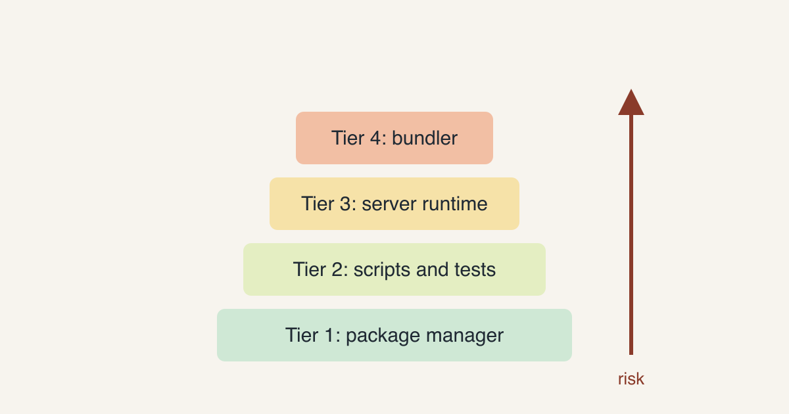
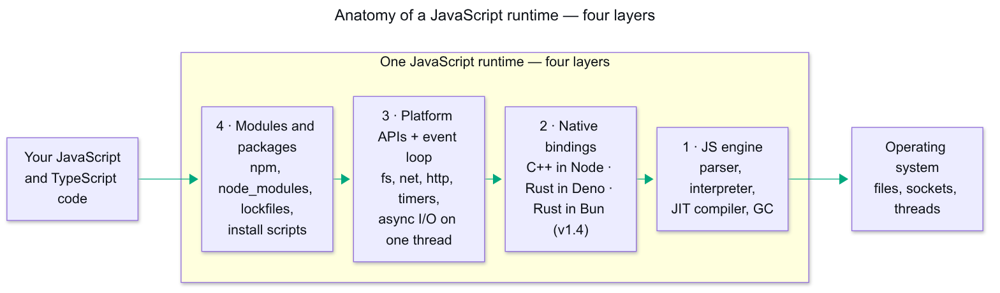
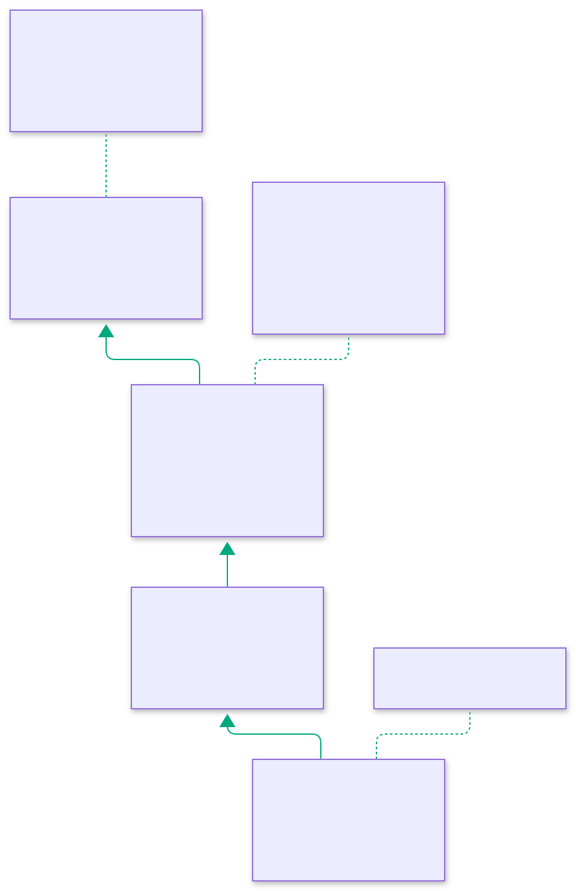

# The War on JavaScript Runtimes: Can Bun Replace Node in a Large Production Monorepo?

> Bun is not one decision. It is four, and they carry very different risk.

"Should we move to Bun?" is a question I keep hearing, and it usually gets a one-word answer. In a large codebase that answer is almost always wrong, because the question hides four separate decisions with very different risk. I recently probed two sibling production monorepos for exactly this, without touching the real repos, and this post is what I measured, what broke, and what I would do.

The timing is not a coincidence. Deno just left the field, and the short version below is now a two-runtime question.

Short version: Bun is an easy yes as a package manager and script runner, a "not yet" as a production server runtime, and not a drop-in for a webpack-based Vue client.

## What Is a JavaScript Runtime, Exactly?

Before the war, the territory. A JavaScript runtime is the program that takes your `.js` or `.ts` and makes it able to touch the real world: files, sockets, timers, other processes. The language itself — syntax, types, promises — is specified elsewhere and looks the same everywhere. What a runtime adds is everything around the language, and it comes in four layers:

- **Layer 1 — the JS engine.** The parser, interpreter, JIT compiler, and garbage collector. Node and Deno embed V8 [15]; Bun embeds JavaScriptCore, Safari's engine [17]. This layer is a solved problem in all three — engines are mature, fast, and interchangeable.
- **Layer 2 — the native bindings.** The glue that exposes the operating system to JavaScript. Node's bindings are largely C++; Deno's are Rust, through the Rusty V8 bindings [18]; Bun's were Zig through 1.3.x and were rewritten in Rust for v1.4.0 (May 2026) [19]. This is where each runtime's identity starts.
- **Layer 3 — platform APIs and the event loop.** `fs`, `net`, `http`, timers, and the loop that schedules async I/O on a single thread. Node's loop comes from libuv [16]; Deno and Bun each wrote their own on top of their bindings. Nearly every "runtime bug" you will meet lives here or above.
- **Layer 4 — modules and packages.** How code loads: npm, `node_modules` layout, lockfiles, install scripts, TypeScript stripping. This layer has no specification, only Node's behavior as de facto law.

Here is why this matters for everything that follows: "Node compatibility" is a layer-4 property, plus a slice of layer 3. When this report says Bun is or is not compatible, it is never talking about the engine — it is talking about how faithfully Bun reproduces Node's upper layers. Every verdict below is therefore a verdict on layer 4, and that is exactly the layer where Deno bet wrong and lost.

## The War So Far

This war had three sides. Node shipped in 2009 and became the gravity well: every tool, tutorial, and CI image targets it first. Deno arrived in 2020 as a clean-slate rethink from Node's original author — TypeScript-first, security-first, and famously without npm [13]. Bun arrived in 2022 from the opposite direction: Node-compatible from day one, selling raw speed [1].

The interesting part is what Deno did next. Deno 2, in October 2024, reversed the founding bet and shipped full Node and npm backwards compatibility [14] — the ecosystem it rejected became the price of admission. And it still was not enough to stay independent: on October 9, 2026, Deno announced it is joining Cloudflare, with the runtime on roughly a year of maintenance releases and Deno Deploy winding down [12].

So the field is down to Node and Bun, and the loser's story is the lens for this whole report: compatibility with the existing ecosystem beat a cleaner design, even after Deno conceded and added it. That is why everything below measures Bun by its Node compatibility — the gaps, the one missing `node:v8` call — rather than by its speed claims.

## Release Trains and LTS

Speed is not the only thing a runtime team ships. How a project versions, patches, and supports its releases decides how much upgrade work lands on you, and the three projects could not differ more.

- **Node ships on a fixed train.** A new major every six months: the April release is Current-only, while the October one — even-numbered, like 22, 24, 26 — becomes LTS and is supported for 30 months [21]. Odd-numbered lines live about six months and never become LTS. The practical meaning: pin an even Node in your Docker image and you can ignore upgrades for two years.
- **Deno had an LTS channel, briefly.** Stable minors on a 12-week schedule, an LTS channel since 2.1 with about six months of backported critical fixes, canary builds on every commit [20]. That LTS line ended in April 2026 — the maintenance-mode reality arrived before the support window did [12].
- **Bun has no LTS at all.** One rolling stable channel with frequent patch and minor releases, plus a canary channel (`bun upgrade --canary`) for pre-release work [19]. Nothing is designated safe to sit on; the assumption is you keep moving.

That last point prices differently per tier. At tiers 1–2 a moving runtime is a mild tax — an upgrade is a version bump in CI. At tier 3 it means the version you pin carries no promised support window, and the jump from 1.3 to 1.4 is the proof: a minor-looking bump that carried a full rewrite of the runtime's ~535K lines of Zig to Rust [19]. This report's probes ran on 1.3.10, the last Zig line — worth remembering when you compare numbers.

## The Case Study (Sanitized)

Two pnpm monorepos from one product family: a back-office app and its customer-facing twin. Each has five packages (client, server, and three shared TypeScript packages).

- **Server:** Express 4, Mongoose 6 on the mongodb 4 driver, BullMQ, ioredis, socket.io, sharp, puppeteer, and `module-alias` for path aliases. Built with `tsc`, started with `node dist/...` under PM2.
- **Client:** Vue CLI on webpack 5.
- **Baseline:** Node 24, pnpm 10, CI and Docker both on a `node:24` image.
- **Tool under test:** Bun 1.3.10.

I worked on throwaway copies with dummy config, and I had no reachable database or Redis. So "the server boots" below means it reached the connect stage. Every number is a single run on one machine under other load, and the pnpm store was warm. Treat the timings as direction, not benchmarks.

## The Four Tiers

Each tier can be adopted, or rejected, on its own.

### Tier 1: Package manager only

`bun install` read the existing `pnpm-lock.yaml` and resolved exactly the same set of packages: 2181 in one repo, 1963 in the other, zero differences [6]. Workspace links (`workspace:*`) resolved, and the sharp and puppeteer postinstalls ran.

| Install | Repo A (larger) | Repo B (smaller) |
|---------|-------|---------|
| pnpm, warm store | 17.2 s | 17.0 s |
| Bun, cold cache | 45.7 s | n/a |
| Bun, warm cache | 22.8 s | 23.2 s |
| Bun, `--linker hoisted` | 18.8 s | not run |

On a warm pnpm store, Bun was not faster at installing. If you were hoping for a big install-time win, this is the place the hype and the measurement part ways. The `node_modules` folder was about 1 GB either way.

Two details matter more than speed:

- Bun ignores pnpm's `onlyBuiltDependencies` and uses its own trusted-dependency list, so you must set `trustedDependencies` explicitly [5].
- Bun's default isolated linker does not reproduce pnpm's `shamefully-hoist` behaviour [7]. With it, the Vue CLI build failed immediately with a missing Babel plugin. Installing with `--linker hoisted` fixed that.

### Tier 2: Script and test runner

This tier mostly worked, with caveats.

- Building the three shared packages: pnpm 9.2 s, `bun run --filter` 5.6 s. Output was byte-identical.
- Server `tsc`: 46.7 s on Node, 48.6 s using Bun only to launch it, and 86.8 s with `bun --bun` forcing the Bun runtime. Same output, zero errors. Forcing Bun made the compiler slower, not faster.
- `vue-tsc` under `bun --bun` was the clear winner: 36.8 s against 81.5 s on Node in the larger repo, and 5.2 s against 20.9 s in the smaller one (those runs were probably warm). Zero errors.
- vitest in the larger repo took 193 s on Node and 204 s under Bun, with the same set of failing tests (the baseline already had failures from my dummy config).
- vitest in the smaller repo passed on Node and when Bun only launched it, but failed every file under `bun --bun` with `NotImplementedError: node:v8 isBuildingSnapshot is not yet implemented in Bun`. The cause was a newer `bson` version pulled in by the in-memory MongoDB test helper; the other repo resolved an older `bson` and passed. Other people have hit the same gap [10][11].
- `bun test`, Bun's own runner, hung for over ten minutes on the full suite and I killed it. A single pure unit file passed.

The pattern to notice: using Bun to launch tools is safe, and forcing Bun's runtime onto those tools is where surprises start.

### Tier 3: Server runtime

Running the compiled server under Bun, and the TypeScript source directly, both got through queue and Redis setup, and the path alias worked. Small probes confirmed sharp, headless puppeteer (including PDF output), Mongoose, the mongodb driver, BullMQ, ioredis, socket.io (polling and websocket), and `module-alias` all load and work [1].

Then the part that stopped me. With the database deliberately unreachable, the full app exited with code 1 about 30 to 40 seconds after the connection failed, in both repos. Node stayed alive and logged the error. Small Mongoose and logging probes behaved the same on both runtimes, so I could not isolate the cause, and I never tested against a reachable database. An unexplained process exit is exactly the kind of difference that is cheap to find in a probe and expensive to find in production.

Two smaller findings:

- `bun --watch` is not a drop-in for nodemon. There is no ignore glob, and in my test the process ID did not change across a restart [2].
- PM2 can run Bun with `interpreter: bun` [3], but my existing `node_args` heap flags would not apply.

### Tier 4: Bundler and client build

This is where it fell over.

- The Vue CLI build on Node: 3 min 36 s in the larger repo.
- With Bun's default install, it failed at once on a missing Babel plugin (the hoisting issue above).
- With a hoisted install but the Bun runtime forced, it ran 5 min 21 s and failed on two CSS data-URL errors inside third-party stylesheets.
- In the smaller repo, the same attempt hung at 0% CPU for 28 minutes inside a type-checker child process before I killed it. The Node build took 1 min 43 s.

Vue CLI itself is in maintenance mode and points users to Vite [9]. I estimated 3 to 6 days to port each client's webpack config to Vite. That is an estimate, not a measurement, but it is work worth doing regardless of Bun. Move the client to Vite for its own reasons, then ask what Bun adds.

## What Would Bite You in Your Own Repo

- **Native modules and postinstall scripts.** Bun's trust model differs from pnpm's, so list `trustedDependencies` explicitly.
- **Hidden hoisting assumptions.** If a tool works only because pnpm hoists, the isolated linker will break it.
- **Node API gaps.** `node:v8` snapshot support is missing in 1.3.10, and a dependency bump can trigger it [1].
- **Environment loading.** Bun auto-loads `.env`. Both of my CI pipelines wrote `NODE_ENV=production` into that file, which would silently change behaviour.
- **Memory flags.** The server's `tsc` build ran out of memory with the repo's 1536 MB heap flag in my copy, so even the Node baseline needed headroom.
- **Docs gaps.** I found no official Bun guidance for Mongoose, puppeteer, sharp or Bitbucket Pipelines, and the official Docker guide covers only a basic image [4]. Those conclusions rest on my own probes.

## A Phased Migration Path With Rollback

1. **Bun as the package manager, optional.** Use `linker = "hoisted"`, explicit `trustedDependencies`, and keep `pnpm-lock.yaml`. Rollback: delete `bun.lock` and run `pnpm i`.
2. **Bun to launch scripts.** Use `bun run --filter`, keep `tsc` on the Node runtime, run `vue-tsc` with `--bun`, and pin the `bson` version where the `node:v8` gap bites.
3. **Move the client to Vite.** Independent of Bun, and the real fix for the slowest part of the toolchain.
4. **Bun as the server runtime.** Only after the exit-on-DB-failure is explained against a real database and Redis, followed by a soak test on staging.

I would not switch the production runtime today.

## When Not to Migrate

- Your install time is already fine and nobody is asking for Bun. Tier 1 gave no speed win for me.
- You rely on native modules and a webpack client, and you cannot afford a soak test.
- Your tests depend on in-memory database helpers that touch Node internals.

Migrate when there is a concrete payoff: faster type-checking in CI, one fewer tool to install, or a fresh service with no legacy baggage.

## What I Would Verify Next

I would rerun the server probe against real MongoDB and Redis to explain the exit, repeat the install timings several times with a cold pnpm store, and check whether newer Bun releases fill the `node:v8` gap.

## References

1. Bun, "Node.js compatibility": https://bun.com/docs/runtime/nodejs-compat
2. Bun, "Watch mode": https://bun.com/docs/runtime/watch-mode
3. Bun, "Run Bun as a daemon with PM2": https://bun.com/docs/guides/ecosystem/pm2
4. Bun, "Containerize a Bun application with Docker": https://bun.com/docs/guides/ecosystem/docker
5. Bun, "Lifecycle scripts": https://bun.com/docs/install/lifecycle
6. Bun, "Lockfile": https://bun.com/docs/install/lockfile
7. Bun, "Isolated installs": https://bun.com/docs/install/isolated
8. Bun, "TypeScript": https://bun.com/docs/runtime/typescript
9. Vue CLI: https://cli.vuejs.org/
10. "Why Mongoose crashes in Bun and how to fix the v8 startupSnapshot bug" (Medium, community write-up): https://medium.com/@zehan9211/why-mongoose-crashes-in-bun-and-how-to-fix-the-v8-startupsnapshot-bug-d8eb5e5ef385
11. "Functions throwing NotImplementedError" (Railway Station, community thread): https://station.railway.com/questions/functions-throwing-not-implemented-error-eefb43c4
12. Deno, "Deno is joining Cloudflare": https://deno.com/blog/cloudflare
13. Deno, "Deno 1.0": https://deno.com/blog/v1
14. Deno, "Announcing Deno 2": https://deno.com/blog/v2.0
15. Node.js, "About Node.js": https://nodejs.org/en/about
16. libuv: https://libuv.org
17. Bun, "Bun 1.0": https://bun.com/blog/bun-v1.0
18. Deno, "Announcing Stable V8 Bindings for Rust" (Rusty V8): https://deno.com/blog/rusty-v8-stabilized
19. Bun, "Rewriting Bun in Rust" (v1.4.0, May 2026): https://bun.com/blog/bun-in-rust
20. Deno, "Stability and releases" (channels and cadence): https://docs.deno.com/runtime/fundamentals/stability_and_releases
21. Node.js, "Previous releases" (LTS schedule and support windows): https://nodejs.org/en/about/previous-releases

All accessed 2026-10-13 (references 12–21 on 2026-10-14). Timings are my own single-run measurements with Bun 1.3.10, Node 24 and pnpm 10.

## Let's Connect

Check more on

- [Website](https://encryptioner.github.io)
- [Blogs](https://encryptioner.github.io/blogs/)
- [Linkedin](https://www.linkedin.com/in/mir-mursalin-ankur)
- [Github](https://github.com/Encryptioner)
- [X (Twitter)](https://twitter.com/AnkurMursalin)
- [Nerddevs](https://nerddevs.com/author/ankur/)

> **Stay in touch.** Get new posts in your inbox: [subscribe to my newsletter on Substack](https://ankurmursalin.substack.com/).
>
> **Support my work.** If this helped, you can [support me on SupportKori](https://www.supportkori.com/mirmursalinankur). Thank you.
